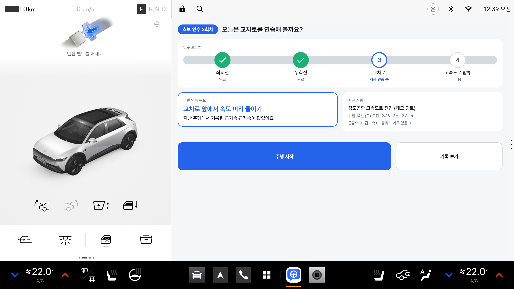
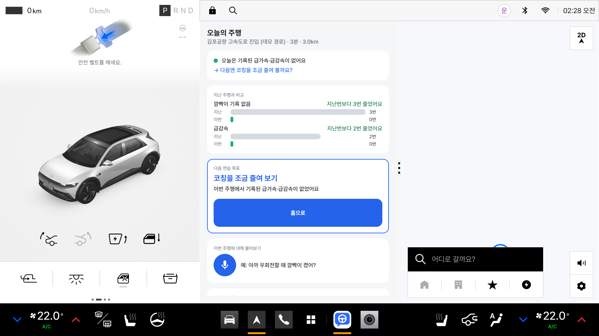

# DriveMate

**차량의 실제 주행 상태와 내비게이션 정보를 연계하여 초보운전자에게 상황별 음성 코칭과 개인 맞춤형 연습 과정을 제공하는 실시간 운전연수 앱**

Pleos Connect(Android Automotive) 차량용 앱입니다. 팀 **MOBINOVA**

## 제출 정보

| 항목 | 내용 |
|---|---|
| APK | [`apk/MOBINOVA_DriveMate_release.apk`](apk/MOBINOVA_DriveMate_release.apk) (release, 서명됨) |
| 에뮬레이터 | Pleos Connect Emulator **v2.1.0** (AVD `Pleos_Connect_v2.1.0`, Android 14, x86_64) |
| 화면 규격 | **2560 × 1440**, 160dpi (가로) |
| 개발 도구 | Android Studio, minSdk 29 / targetSdk 36 |

## 시연 영상

[유튜브 링크]

## 왜 만들었나

면허는 땄지만 혼자 운전대를 잡는 게 두려운 초보운전자가 많습니다.
옆자리에서 "곧 좌회전이야, 깜빡이 미리 켜" 하고 말해 줄 사람이 없으면, 한 번의 실수가 그대로 두려움으로 남습니다.
DriveMate는 옆자리 연수 강사처럼 다음 상황을 미리 알려 주고, 주행이 끝나면 무엇을 연습하면 좋을지 차분히 정리해 줍니다.
혼자서도 조금씩 연습해 운전에 자신감을 붙이는 것이 목표입니다.

## 스크린샷

| 홈 (연수 로드맵) | 주행 중 (내비와 반반 분할) | 주행 리포트 |
|---|---|---|
|  |  |  |

## 주요 기능

### 1. 상황 예고 음성 코칭
내비 경로에서 다음 상황과 남은 거리를 받아, 그 지점에 닿기 전에 미리 음성으로 알려 줍니다.

| 상황 | 안내 시점 |
|---|---|
| 좌회전·우회전 | 300m 전 |
| 교차로 | 200m 전 (주행 준비에서 연습 주제로 골랐을 때) |
| 고속도로 진입·합류 | 500m 전 |

- **초보 · 자세히** 모드는 좌·우회전을 항상 자세히, **일반 · 간단히** 모드는 고른 연습 주제만 짧게 안내합니다.
- 같은 지점은 한 번만 안내하고, 50m보다 가까우면 말하지 않습니다 (회전 중에 말 걸지 않기).
- **쓰는 데이터**: 내비 다음 안내 종류·남은 거리(NaviHelper), 차량 속도, 내비 음성 재생 여부

### 2. 주행 이벤트 기록
주행 중에는 말없이 기록만 하고, 리포트에서 보여 줍니다.

- **급가속·급감속**: 한국교통안전공단 운행기록분석시스템(eTAS) 위험운전행동 기준
  - 급가속: 1초에 시속 11km 이상 증가 (정차 후 출발 중인지 함께 기록)
  - 급감속: 1초에 시속 7.5km 이상 감소 (회전·교차로 100m 앞인지 함께 기록)
- **방향지시등**: 회전 지점 100m 앞에서 회전 방향과 **같은 쪽** 깜빡이를 켰는지(왼쪽·오른쪽 구분), 처음 켠 순간 회전 지점까지 **남은 거리**
- **교차로·고속도로 합류 지점 통과** (연수 로드맵 단계 판단용)
- **쓰는 데이터**: 차량 속도·기어, 방향지시등 상태, 브레이크 페달 상태, 내비 다음 안내, 위치

### 3. 말로 질문하기
마이크 버튼을 누르고 말하면 음성으로 답합니다. 주행 중에도, 주차 후 리포트 화면에서도 쓸 수 있습니다.

- **교통법규 질문**: 비보호 좌회전, 우회전, 차선 변경, 황색 신호 (도로교통법 기준으로 검토해 미리 쓴 답변)
- **주행 기록 질문**: "깜빡이 켰어?", "오늘 부족했던 점은 뭐야?", "어떤 부분을 더 연습하면 좋을까?"
  - 예: "네, 우회전 80미터 전에 오른쪽 깜빡이를 켜셨어요. 30미터 전 기준보다 여유 있게 잘 켜셨어요."
  - 답은 "기록된 사실 → 다음에 해 볼 것" 순서로 두 문장 안에서 말합니다.
- **쓰는 데이터**: 음성 인식(SpeechToText), 음성 출력(TextToSpeech), 이번 주행 기록

### 4. 주행 리포트
기어를 P로 바꾸면 주행이 끝나고 리포트가 열립니다.

- **원인 → 처방 카드**: "우회전 3번 중 2번은 깜빡이 기록이 없었어요 → 회전 지점 30미터 전에는 꼭 켜 두세요"
- **지난 주행과 비교**: 깜빡이 기록 없음·급감속·급가속·불규칙한 속도 변화 횟수. 줄었으면 칭찬하고, 늘었으면 횟수만 알려 줍니다.
- **다음 목표 1개**: 가장 많이 나온 항목을 다음 연습 목표로 정합니다. 고칠 점이 없으면 연수 로드맵의 지금 단계를 목표로 합니다.
- **쓰는 데이터**: 저장된 주행 기록(이벤트, 질문)

### 5. 연수 로드맵
**좌회전 → 우회전 → 교차로 → 고속도로 합류** 순서로 연습 단계를 보여 주고, 실제 주행 기록으로 단계를 완료 처리합니다.

| 단계 | 완료 기준 (팀 기준값) |
|---|---|
| 좌회전 / 우회전 | 그 회전이 있는 주행 2번 연속, 회전할 때마다 같은 쪽 깜빡이 기록 있음 |
| 교차로 | 교차로를 지난 주행 2번 연속, 회전·교차로 앞 급감속 없음 |
| 고속도로 합류 | 합류 지점을 지난 주행 1번 |

홈 화면 인사말("오늘은 교차로를 연습해 볼까요?")도 지금 단계를 따라갑니다.

## 안전 원칙

- **내비 안내 우선**: 내비가 길 안내 음성을 말하는 동안에는 코칭을 기다렸다가, 내비가 끝난 뒤에 말합니다. 기다리는 사이 지점을 지나쳤으면 늦은 안내는 하지 않습니다.
- **주행 중 화면 최소화**: 주행 화면의 버튼은 마이크와 주행 끝내기(길게 눌러야 동작) 2개뿐입니다. 글자는 크게, 말풍선은 짧은 한 문장만 띄우고 움직이는 그림은 쓰지 않습니다.
- **주행 중엔 지적 대신 기록**: 급가속·급감속이 생겨도 주행 중에는 화면에 표시하거나 말하지 않고, 주행이 끝난 뒤 리포트에서 알려 줍니다.
- **모르는 상황에서 주행 지시를 하지 않음**: 답을 준비하지 않은 질문에는 추측해서 답하지 않고 "그 질문은 정차 후 다시 물어봐 주세요."라고 말합니다. 기록에 없는 도로 상황은 판단하지 않습니다.

## Pleos SDK 활용

| SDK | 받는 값 | 어디에 쓰나 |
|---|---|---|
| **Vehicle** (2.0.3) | 방향지시등 상태(왼쪽·오른쪽·꺼짐) | 회전 전 깜빡이 기록, 켠 거리 |
| | 브레이크 페달 상태 | 이벤트 기록에 함께 저장 |
| **NaviHelper** (3.0.5) | 다음 안내(TBT: 회전 종류·남은 거리), 경로 상태, 목적지 | 상황 예고 코칭, 회전·교차로·합류 통과 판단, 주행 준비의 목적지 표시 |
| **SpeechToText** (3.3.1, ON_DEVICE) | 한국어 음성 인식 결과 | 말로 질문하기 |
| **TextToSpeech** (3.3.1, ON_DEVICE) | 음성 재생, 재생 끝 알림 | 코칭·답변 음성 |
| AAOS Car API (CarPropertyManager) | 차량 속도, 기어 | 급가속·급감속 판단, 주행 거리, 기어 P로 주행 끝 → 리포트 |
| Android 기본 API | 위치(LocationManager), 내비 음성 재생 여부(AudioManager) | 이벤트 위치 기록, 내비 안내 우선 |

음성 인식·출력은 ON_DEVICE 모드라 인터넷 연결 없이 차량 안에서 동작합니다.

## 기술 구성

- Kotlin, Jetpack Compose (화면), Hilt (의존성 주입), Room (주행 기록 저장)
- minSdk 29 / targetSdk 36, 모듈은 `automotive` 하나
- 코칭·이벤트 판단·리포트 규칙은 안드로이드와 분리된 순수 Kotlin 코드라 PC에서 단위 테스트로 확인합니다.

```
automotive/src/main/java/com/example/drivemate/
├─ vehicle/   차량·내비·위치 데이터 받기 (Pleos Vehicle, NaviHelper)
├─ voice/     음성 입력·출력 (Pleos SpeechToText, TextToSpeech)
├─ event/     급가속·급감속·회전 깜빡이 판단
├─ coaching/  상황 예고 코칭 규칙, 질문 답변
├─ report/    리포트, 지난 주행 비교, 연수 로드맵
├─ drive/     주행 한 번의 흐름 (시작 → 기록 → 끝)
├─ data/      주행 기록 저장 (Room)
└─ ui/        화면 (홈, 주행 준비, 주행 중, 리포트, 기록)
```

## 실행 방법

### APK로 바로 실행 (심사용)

1. Pleos Connect Emulator v2.1.0을 켭니다.
2. APK를 설치합니다.
   ```bash
   adb install -r apk/MOBINOVA_DriveMate_release.apk
   ```
3. 앱 목록에서 **DriveMate**를 엽니다. 이후 순서는 아래 소스 실행의 4~8번과 같습니다.

에뮬레이터 내비는 위치가 움직이지 않기 때문에, 앱이 에뮬레이터에서 실행되면 release APK도 연습 경로를 자동으로 사용합니다. 실차에서는 실제 내비 경로를 씁니다.

### 테스트 환경 및 필요한 설정

- Pleos Connect Emulator v2.1.0 (2560 × 1440). 추가 계정이나 API 키는 필요 없습니다.
- 권한: 마이크(음성 질문), 위치. 첫 실행 때 허용합니다.
- 음성 질문을 쓰려면 에뮬레이터 Extended Controls > Microphone에서 **Host Microphone Access**를 켭니다. 에뮬레이터를 다시 켜면 꺼질 수 있습니다.
- 기어·속도·방향지시등은 에뮬레이터의 **Virtual Console**에서 바꿉니다.

### 소스에서 실행

Android Studio와 Pleos Connect Emulator 기준입니다.

1. Android Studio에서 이 프로젝트를 엽니다. Pleos SDK는 `settings.gradle.kts`에 적힌 Pleos 저장소에서 자동으로 내려받습니다.
2. Device Manager에서 Pleos Connect Emulator를 켭니다.
3. 실행 구성에서 `automotive`를 고르고 ▶ 실행합니다 (debug 빌드).
4. 처음 실행하면 권한 요청(마이크, 위치 등)을 허용합니다.
5. 에뮬레이터의 내비는 차가 움직여도 위치가 바뀌지 않기 때문에, debug 빌드는 실제 내비 로그에서 옮긴 연습 경로(목적지 "이마트 성남점")를 자동으로 사용합니다. 경로를 따라가는 거리는 차량 속도로 계산합니다.
6. 홈에서 **주행 시작** → **출발하기**를 누릅니다.
7. 에뮬레이터의 Virtual Console에서 기어를 **D**로 바꾸고 속도를 올리면 연습 경로를 따라 달리고, 회전이 다가오면 코칭이 나옵니다. 방향지시등도 Virtual Console에서 켤 수 있습니다.
8. 기어를 **P**로 바꾸면 주행이 끝나고 리포트가 열립니다.

단위 테스트:

```bash
./gradlew :automotive:testDebugUnitTest
```

## 앞으로의 계획 (2차)

- **Gleo 음성 호출 연동**: 마이크 버튼 없이 차량 음성 비서로 질문하기
- **AI 대화형 코치**: 미리 쓴 답변 대신, 주행 기록을 바탕으로 대화하듯 답하는 코치 (질문 답변 부분을 바꿔 끼울 수 있게 만들어 두었습니다)
- **차선 변경 코칭**: 지금은 질문 답변만 지원
- **제한속도 기반 과속 코칭**: 도로 제한속도와 차량 속도를 비교

## 글꼴 라이선스

글꼴 Pretendard는 SIL Open Font License 1.1(OFL)을 따릅니다. 전문은 [`LICENSE_Pretendard.txt`](LICENSE_Pretendard.txt)에 있습니다.
