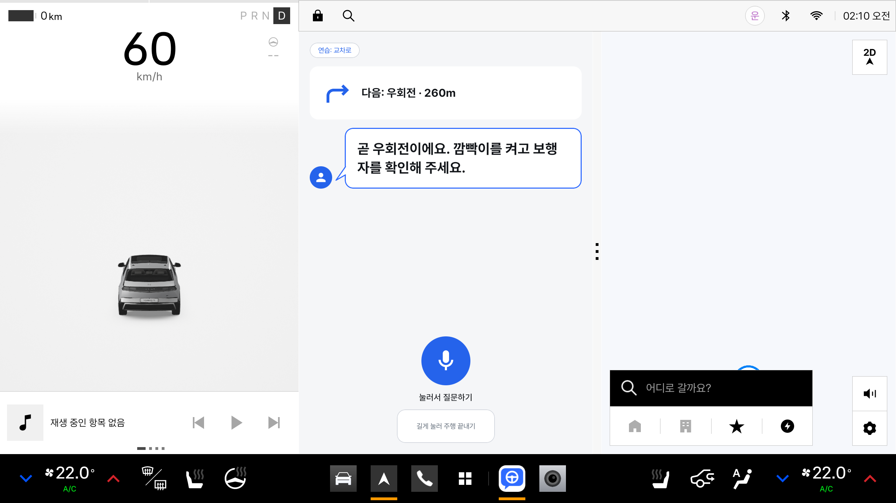

# DriveMate

- **한 줄 소개**: 차량 주행 상태와 내비 정보를 연계해 초보운전자에게 상황별 음성 코칭과 맞춤 연습 과정을 주는 실시간 운전연수 앱
- 팀: **MOBINOVA** / 플랫폼: Pleos Connect (Android Automotive)

## 만든 이유

- 면허를 따도 혼자 운전하기 두려운 초보운전자가 많음
- 옆자리에서 "곧 좌회전, 깜빡이 미리 켜" 하고 말해 줄 사람이 없으면 실수가 두려움으로 남음
- DriveMate가 연수 강사처럼 다음 상황을 미리 알려 주고, 주행 후 연습할 점을 정리해 줌

| 홈 (연수 로드맵) | 주행 중 (내비와 분할) | 주행 리포트 |
|---|---|---|
|  |  |  |

## APK 위치

- [`apk/MOBINOVA_DriveMate_release.apk`](apk/MOBINOVA_DriveMate_release.apk) (release, 서명됨)

## 개발 환경

- 에뮬레이터: Pleos Connect Emulator **v2.1.0** (Android 14, x86_64)
- 화면 규격: **2560 × 1440**, 160dpi, 가로
- Android Studio / Kotlin, Jetpack Compose, Hilt, Room / minSdk 29, targetSdk 36

## 실행 방법

1. Pleos Connect Emulator v2.1.0 실행
2. APK 설치: `adb install -r apk/MOBINOVA_DriveMate_release.apk`
3. 앱 목록에서 **DriveMate** 실행 → 권한(마이크·위치) 허용
4. 홈 **주행 시작** → **출발하기**
5. Virtual Console에서 기어 **D**, 속도 올리기 → 회전 300m 전 음성 코칭
6. 기어 **P** → 주행 종료, 리포트 표시

- 소스 실행: Android Studio에서 프로젝트 열기 → `automotive` 구성 ▶ 실행 (Pleos SDK는 자동 다운로드)
- 단위 테스트: `./gradlew :automotive:testDebugUnitTest`

## 테스트 환경 및 필요한 설정

- 추가 계정·API 키 불필요, 인터넷 없이 동작 (음성 인식·출력 ON_DEVICE)
- 기어·속도·방향지시등: 에뮬레이터 **Virtual Console**에서 조작
- 음성 질문: Extended Controls > Microphone > **Host Microphone Access** 켜기 (에뮬레이터 재시작 시 꺼질 수 있음)
- 에뮬레이터 내비는 위치가 움직이지 않음 → 에뮬레이터에서는 연습 경로(목적지 "이마트 성남점") 자동 사용, 실차에서는 실제 내비 경로 사용

## 주요 기능

- **상황 예고 음성 코칭**: 좌·우회전 300m, 교차로 200m, 고속도로 합류 500m 전 안내 (NaviHelper TBT + 차량 속도)
- **주행 이벤트 기록**: 급가속·급감속(eTAS 기준), 회전 방향과 같은 쪽 방향지시등 사용 여부·켠 거리
- **말로 질문하기**: 교통법규 질문, 주행 기록 질문("깜빡이 켰어?") 음성 답변
- **주행 리포트**: 원인 → 처방 카드, 지난 주행 비교, 다음 목표 1개
- **연수 로드맵**: 좌회전 → 우회전 → 교차로 → 고속도로 합류, 주행 기록으로 단계 완료

## 안전 원칙

- 내비 음성 안내 중에는 코칭 대기
- 주행 중 버튼 2개(마이크, 길게 눌러 종료), 짧은 한 문장만 표시
- 주행 중 지적 없이 기록만, 리포트에서 알림
- 준비 안 된 질문엔 추측 답변 없음 ("정차 후 다시 물어봐 주세요")

## Pleos SDK 활용

- **Vehicle**: 방향지시등, 브레이크 페달
- **NaviHelper**: 다음 안내(회전 종류·남은 거리), 경로 상태, 목적지
- **SpeechToText / TextToSpeech** (ON_DEVICE): 질문 인식, 코칭·답변 음성
- AAOS Car API: 차량 속도, 기어

## 글꼴 라이선스

- Pretendard, SIL Open Font License 1.1 ([`LICENSE_Pretendard.txt`](LICENSE_Pretendard.txt))
